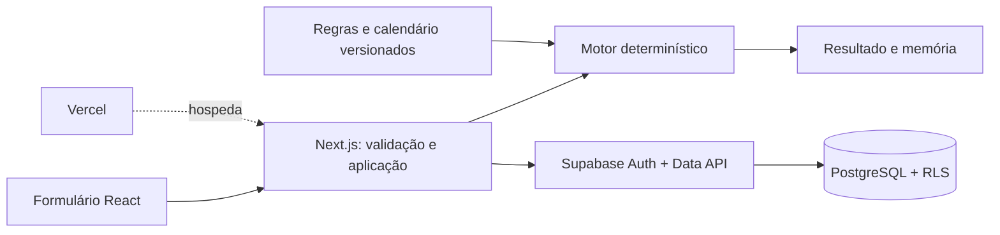

# Arquitetura e modelo de dados

## Fronteiras

Monólito modular Next.js com React/TypeScript, Tailwind, componentes acessíveis do ecossistema shadcn/Radix, React Hook Form e Zod. Um serviço separado NestJS e um monorepo acrescentariam operação antes de haver uma necessidade demonstrada. O motor TypeScript usa Temporal, com polyfill quando necessário, e permanece executável em testes sem Next.js ou conexão externa.

Vercel é a plataforma de hospedagem estabelecida; Supabase é o backend estabelecido. Migrations versionadas descrevem o banco. Na primeira fatia, `supabase-js` acessa a Data API sob a identidade autenticada; `@supabase/ssr` trata clientes/sessão. Validação e autorização no servidor complementam RLS. A [Data API](https://supabase.com/docs/guides/api), a documentação de [RLS](https://supabase.com/docs/guides/database/postgres/row-level-security) e de [SSR](https://supabase.com/docs/guides/auth/server-side/creating-a-client?queryGroups=framework&framework=nextjs) fundamentam a integração.

Drizzle está adiado para evitar uma segunda via de acesso SQL nesta fatia. Uma conexão direta que usa papéis privilegiados exigiria tratamento explícito da identidade e das políticas. O ADR 0002 registra a decisão e o gatilho para reconsiderá-la.

## Contrato do cálculo

Continuação local em 21/10/2026: civil preserva motor 0.2.0; trabalhista/criminal usam 0.3.0, regra própria e calendário compatível. [Decisão de preservação](architecture/adr/0004-perfis-explicitos-e-motor-civil-preservado.md), [plano ativo](continuation-plan.md) e [evidências](testing/multi-regime.md). `context` é obrigatório nos novos perfis; somente `ordinary` confirmado é elegível. O schema recusa tribunal/localidade incompatíveis; contexto desconhecido/especial produz incompleto. Criminal distingue `nominalDueDate` e trilha `extension`, que não consome unidades. Publicação depende de expediente, enquanto contagem depende também de suspensão; essas decisões não usam um único predicado indistinto.

Entrada lógica: regime, tribunal/localidade, suporte dos autos quando relevante, meio/evento, data civil ou instante com fuso, quantidade/unidade, regra/versionamento, calendário/cobertura e exceções suportadas. Entrada inválida ou modalidade fora da fatia falha de forma explícita.

Saída lógica: estado, evento original, comunicação considerada, dia do começo, primeiro dia computado, vencimento quando determinável, trilha cronológica, fundamento de cada decisão, fontes/versões e pendências. O contrato da fatia usa `status: provisional | incomplete` e `dueDate: string | null`: provisório pode conter data simulada dentro da cobertura declarada; incompleto usa vencimento nulo. A interface deve comunicar essa distinção.

O motor fica em `src/domain/deadlines/`, com `calculateDeadline(input, calendar)`; o catálogo demonstrativo fica em `src/domain/calendars/tjsp-2026.ts`. A aplicação em `src/application/calculate.ts` valida o schema e seleciona o calendário interno antes de chamar o motor. A API pública `POST /api/calculate` recebe a entrada, sem confiar em um calendário enviado pelo navegador; `/api/history` é privada. Endpoints de autenticação pertencem à aplicação, separados da contagem.

Datas civis são `PlainDate` ou ISO `YYYY-MM-DD` nas fronteiras serializadas. Metadados de consulta/criação são instantes e ficam fora da decisão de contagem. Relógio e rede pertencem à aplicação, nunca ao motor.

## Versionamento e reprodução

Catálogo inicial de atos em 22/10: `acts.ts` mantém a versão `2026-10-22.demo.1`; `calculate-act.ts` faz a validação de enquadramento e compõe o resultado (`engineVersion:0.4.0`). Somente entradas com `act` passam por essa camada. A contagem delegada permanece civil 0.2.0 ou ordinária 0.3.0, identificada em `countingEngineVersion`; não há alteração nos algoritmos congelados nem em calendários. Bloqueios do ato são avaliados antes da contagem, sem criar e depois ocultar um vencimento. O catálogo e o motor continuam puros, sem relógio, banco ou rede.

`input.act` guarda ID/versão e declaração de condições; `snapshot.act` copia a ficha, duração e fontes. O JSON existente do histórico comporta os campos opcionais, sem nova tabela/migration. Leitura defensiva mantém versões antigas sem ato; a coincidência para recálculo inclui as versões do ato e da contagem delegada. Propriedade/RLS e o estado não verificado dos snapshots não mudam. [Contrato HTTP](api/README.md) e [pesquisa](legal/rules/procedural-acts-2026-10-22.md).

Regras têm identificador estável e versões com vigência, âmbito e revisão. Calendários têm versão, cobertura, escopo, fontes e estado de completude. Cálculos históricos preservam entrada e snapshot das regras/calendário utilizados, além de suas referências. Alterações geram versões novas; manter uma referência para uma linha mutável não é suficiente para reproduzir o resultado.

O catálogo local permite demonstração e testes. A persistência remota somente é considerada integrada após migrations, sessão, gravação, leitura e isolamento serem verificados. Um registro salvo precisa manter a indicação de demonstração e todas as pendências originais.

Em 20/10/2026, `sp-2026.ts` seleciona dez calendários municipais, todos demonstrativos, preservando `tjsp-2026.ts` como versão anterior. Motor 0.2.0; regra civil preservada. Histórico anterior sem versão disponível para reexecução continua com `recomputed: null`. A visualização valida estrutura e links HTTPS, informa que não atesta autenticidade e exporta `originalSnapshot` integral com `integrity: unverified`.

## Entidades e implementação incremental

Continuação externa de 23/10: `deadline_reminders.delivery_mode` preserva os legados como `local`; RPCs com nomes próprios permitem agendamento/claim/listagem por modo explícito. Claim antigo permanece local, incluindo manutenção de leases/janelas. Listagem invoker limita proprietário e modo sem retornar payload privilegiado; cancelamento geral segue abrangendo os dois modos da própria conta. [Contrato](email-reminders-external.md) e [105 testes SQL/advisors/migration reproduzida localmente](testing/reminder-delivery-modes.md). A aplicação externa e o scheduler têm aceites separados; essa migration não habilita envios nem altera memória, motor ou calendários.

Lembretes locais de 23/10: [ADR 0005](architecture/adr/0005-fila-de-lembretes-e-envio-incerto.md) e [contrato](email-reminders.md). `deadline_reminders` preserva proprietário, cálculo, vencimento/opções/versões e estado separado da memória. Leitura por proprietário com RLS; escrita por wrappers invoker e implementações limitadas em `reminder_private`, não exposto pela Data API. Schedule/cancel verificam identidade; claim/prepare/settle são exclusivos do papel de serviço. A leitura mais recente por cálculo ocorre no banco antes da resposta, sem um limite global que omita estados de outra página.

Dispatcher Next.js usa credencial privilegiada exclusivamente em código `server-only`, sem cookies de usuário, segredo Bearer próprio e configuração restrita a loopback. Claim com token/SKIP LOCKED, tentativas limitadas e estado incerto evitam reenvio automático após possível aceite. Adaptador Mailpit confere retransmissão externa desativada, prepara conteúdo mínimo e não usa SMTP do Auth. Script local consulta a cada minuto enquanto ativo; não existe scheduler hospedado. Relógio da fila pertence à aplicação/Postgres, sem alterar motor ou calendários. E-mail aponta para histórico filtrado por UUID/proprietário; snapshot não verificado e avisos preservados.

Organização do histórico em 22/10: GET usa intervalo/contagem restritos ao proprietário verificado, filtro JSON de regime e ordem total por `created_at,id`. Fallback de intervalo esvaziado mantém o escopo. Relógio exclusivamente na aplicação: captura data de referência em São Paulo e acrescenta situação comparativa do vencimento original validado, sem persistir estado móvel ou tocar no motor. UI cancela consultas anteriores, vincula dados à seleção atual, refaz totais após exclusão e identifica a busca local por página. Sem nova tabela/migration ou mudança de RLS. [Contrato](history-organization.md).

Continuação de 22/10: calendário trabalhista Capital 2027 e composição contígua 2026–2027. `composeCalendars` verifica compatibilidade/continuidade e registra `components`, com referências imutáveis a cada versão anual; eventos e fontes são copiados para o snapshot completo. `calculateForMvp` conserva a seleção anual de 2026 se suficiente e tenta a composição somente após um percurso incompleto que alcançou o fim daquela cobertura. Eventos de 2027 usam a versão anual de 2027. O motor 0.3.0 não mudou; relógio/rede seguem fora dele. `historySnapshotSchema` aceita componentes opcionais; nenhuma tabela, autorização ou RLS mudou. [Contrato e fontes](legal/sources/labor-sp-2027.md).

Ampliação territorial criminal de 21/10: `criminal-sp-comarcas-2026.ts` seleciona o calendário municipal sem alterar os catálogos civis ou o criminal inicial da Capital. A regra criminal `.demo.1` permanece na Capital; a `.demo.2` registra o novo âmbito nos demais nove municípios. Algoritmo 0.3.0 preservado; autorização, JSON de histórico e RLS não mudam. Não existe seleção automática de TRT-15/2027 nem inferência de calendário de outro tribunal. [Proveniência e aceites](legal/sources/criminal-sp-comarcas-2026.md).

Os nomes abaixo descrevem o modelo de destino, não afirmam a existência de todas as tabelas na primeira migração. O schema SQL versionado é a autoridade sobre o que existe no banco.

| Entidade | Necessidade e momento |
| --- | --- |
| User / Profile | Identidade do Supabase Auth e dados mínimos do perfil; necessário ao histórico privado. Papéis administrativos não são editáveis pelo perfil do usuário. |
| Organization / Membership | Escritórios/equipes e seus membros; adiado para a segunda fatia para evitar colaboração incompleta. A primeira usa proprietário individual. |
| Court | Identifica tribunal e âmbito; necessário para impedir aplicar calendário de outro tribunal. |
| CourtUnit | Foro/unidade, com UF/município/comarca; o catálogo inicial deve declarar a precisão efetivamente levantada. Expansão depende de fontes locais. |
| JudicialCalendar | Versão e cobertura do calendário por âmbito; necessário à reprodutibilidade. |
| CalendarEvent | Datas/períodos, natureza e efeito de ocorrência; necessário à trilha de exclusões. |
| CalendarSource | Ato, URL, órgão, data de consulta, vigência e estado de conferência; evita feriado sem origem. |
| LegalSource | Norma primária e dispositivo aplicável; distingue texto legal de decisões de implementação. |
| LegalRule / LegalRuleVersion | Identidade, versão, vigência e revisão de uma regra; evita sobrescrever interpretação histórica. |
| ProceduralEvent | Dados do fato informado pelo usuário e meio de comunicação; inicialmente pode integrar o snapshot do cálculo, sem tabela separada. |
| DeadlineCalculation | Proprietário, entrada, versões, estado e resultado; necessário ao histórico. |
| CalculationTrace | Inclusões/exclusões e fundamentos; inicialmente pode integrar o snapshot JSON, separado logicamente dos dados normativos. |
| CalculationAudit | Revisões/divergências e autoria; trilha administrativa futura, sem alegar imutabilidade só por existir JSON. |
| SavedCase | Agrupa cálculos sob um processo; adiado até justificar dados pessoais e retenção. |
| DeadlineReminder | Preferência e ativação por cálculo, vencimento/versões originais, horário e resultado das tentativas; implementado na primeira fatia local de lembretes. |
| NotificationPreference | Preferências globais de conta e outros canais; adiadas. Cancelamento de todos os lembretes ativos já existe no recorte individual. |

Organizações futuras exigirão memberships controladas, owner/membro por política, constraints de pertencimento, índices e testes de isolamento entre organizações. A migração desse modelo deve preservar o proprietário dos cálculos existentes. Storage só será adicionado com arquivos necessários e buckets privados com políticas.

## Segurança e entrega

Agendador de lembretes em 23/10: pg_cron chama pg_net somente com trabalho externo elegível; preparação cria job inativo. Chave dedicada no Vault/servidor assina operação, timestamp e nonce, sem passar credencial permanente pela fila legível do pg_net. RPC exclusiva de serviço consome a invocação uma única vez antes do dispatcher. Probe verifica configuração sem claim/envio; ativação requer probe consumido, recente e com entrega habilitada. Metadados operacionais privados têm retenção de sete dias, separada do histórico processual. [ADR 0006](architecture/adr/0006-agendamento-com-assinatura-descartavel.md) e [procedimento de operação/suspensão](reminder-scheduler-operations.md). Instalação local não equivale a ativação hospedada.

Anon lê apenas catálogos públicos deliberadamente liberados; usuário autenticado acessa seus cálculos. Escrita normativa é administrativa, com fluxo de revisão separado. RLS, constraints, integridade referencial e índices pertencem às migrations; a UI não concede autorização. Logs e fixtures evitam nomes de partes e números processuais reais.

Desenvolvimento, preview e produção usam configurações e dados isolados. As [configurações de ambientes Vercel](https://vercel.com/docs/deployments/environments) orientam a separação. Credenciais privilegiadas não entram em `NEXT_PUBLIC_*`, logs ou exportações. Backups, retenção/exclusão, rate limiting e observabilidade precisam de verificação antes de operação pública. Ver `docs/security/`, `docs/testing/` e o backlog para evidências e pendências.
