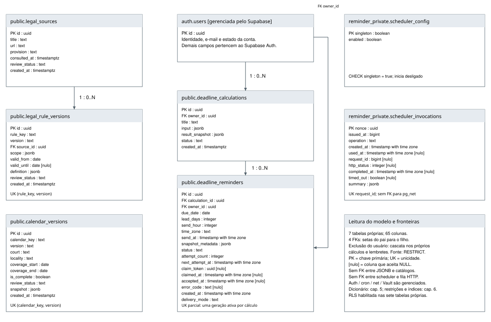
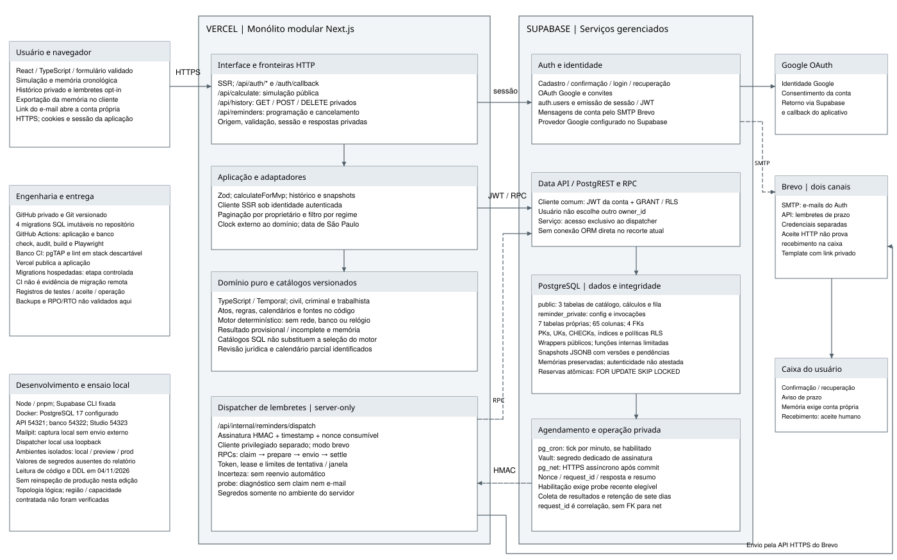

# Banco de dados e arquitetura completa

## Modelo físico implementado

As quatro migrations do projeto definem **sete tabelas próprias**, **65 colunas**, **quatro chaves estrangeiras**, **sete índices explícitos**, **sete políticas RLS** e **22 definições finais de funções**. Objetos gerenciados pelo Supabase e pelas extensões ficam fora dessas contagens.

| Schema | Estruturas próprias |
| --- | --- |
| public | legal_sources, legal_rule_versions, calendar_versions, deadline_calculations, deadline_reminders |
| reminder_private | scheduler_config, scheduler_invocations |

A identidade vem de `auth.users`. Fonte e regra possuem FK; cálculos e lembretes pertencem ao usuário; lembretes apontam para o cálculo. O snapshot JSONB não cria FKs para os catálogos. O ID HTTP do agendador é uma correlação, sem FK para a fila da extensão.

## Diagrama geral do banco

[Ampliar diagrama em PDF](../../../docs/relatorio-banco/diagramas/banco-geral-completo.pdf) · [Abrir SVG vetorial](../../../docs/relatorio-banco/diagramas/banco-geral-completo.svg)

## Arquitetura completa

[Ampliar arquitetura em PDF](../../../docs/relatorio-banco/diagramas/arquitetura-completa.pdf) · [Abrir SVG vetorial](../../../docs/relatorio-banco/diagramas/arquitetura-completa.svg)

## Aprofundamento

O [relatório completo navegável](../../../docs/relatorio-banco/relatorio.md) inclui concepção, normalização, dicionário com tipos/defaults, integridade, índices, permissões, funções e fluxos. O [PDF único de 36 páginas](../../../output/documents/prazo-claro-relatorio-banco-de-dados-2026-11-04.pdf) reúne todo o material e duas pranchas A3.

Os modelos representam a implementação e sua topologia lógica, sem alegar capacidade contratada, testes de carga ou nova inspeção de produção nesta edição.
